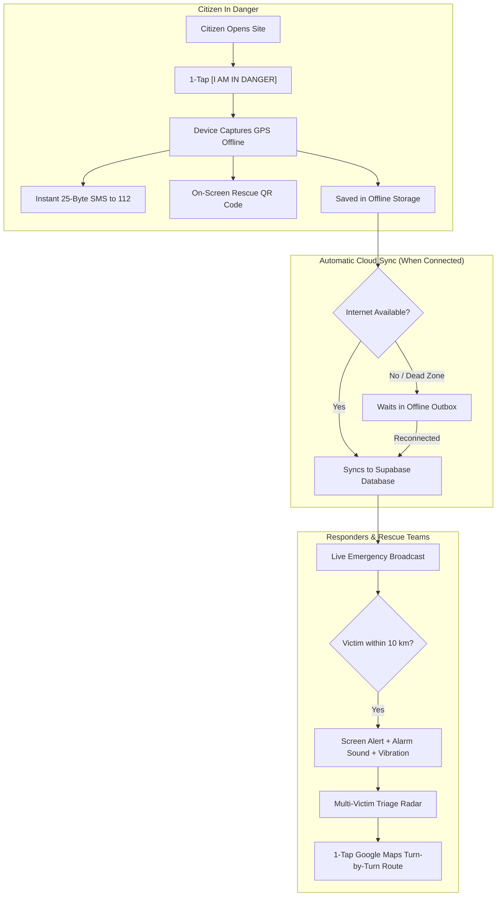
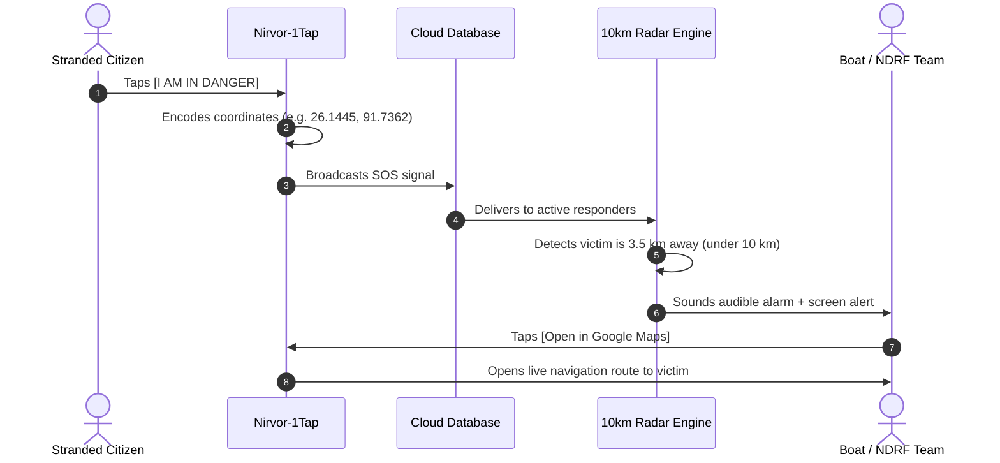

# 🛡️ NIRVOR-1TAP (Northeast Connect)
### Community Emergency & Disaster Assistant for North East India

> **An offline-first emergency platform built for the 8 North Eastern states of India.**  
> Built to keep working when mobile networks collapse, roads get cut off, power fails, and ordinary apps stop working.

---

## 🌊 The Reality in North East India

During every monsoon season, North East India faces severe flash floods, landslides, and cloudbursts — from the Brahmaputra valley in Assam to the hills of Meghalaya, Sikkim, and Arunachal Pradesh. 

When a disaster hits, **the first thing that goes down is mobile internet**. 

Most emergency apps today assume you have fast 4G/5G, a charged phone, and Google Maps running smoothly. **In a real flood or landslide, there is no 4G, no cellular data, and no time to fill out complex forms.**

**NIRVOR-1TAP is designed specifically for this reality:**
- It opens and runs **100% offline** right from your browser.
- It comes pre-loaded with **3,220+ verified emergency facilities** (hospitals, relief shelters, police, and fire stations) across all 8 NE states.
- It requires **zero accounts, zero passwords, and zero setup** — anyone can use it in seconds.
- It costs **₹0 to run** because it uses zero paid APIs (no paid Google Maps, no paid Twilio, no paid cloud fees).

---

## 🧭 How It Works (At a Glance)



---

## 💡 Detailed Walkthrough of Every Feature

### 1. 1-Tap Emergency SOS
- **What it does**: A single red button for anyone in immediate life danger.
- **Why it matters**: In a panic, no one can type long paragraphs or remember emergency numbers.
- **How it works**:
  - Automatically fetches your current GPS coordinates.
  - Lets you choose your emergency type (Flood, Landslide, Trapped, Medical, Roadblock) and headcount with one tap.
  - Generates an instant SMS pre-addressed to **112 (National Emergency)** with your exact location and status.
  - Generates an **offline QR code** on your phone screen. Even if you have zero signal, an SDRF rescuer or boat team can scan your phone to get your coordinates and triage details.

---

### 2. Multi-Victim & Multi-Responder Dispatch Radar
- **What it does**: A live triage queue for field rescue teams and volunteers managing multiple victims across different flooded areas.
- **Why it matters**: Disasters never affect just one person. Rescuers need to see all stranded people in their area without messages getting lost.
- **How it works**:
  - Responders turn on **Responder Mode** at the top of the screen.
  - The app tracks the responder's current location and scans for all nearby distress calls.
  - A floating **Radar Bubble** shows the total count of active emergency calls.
  - Clicking the bubble opens the **Triage Dispatch Board**:
    - Cycle through victims with simple `<` and `>` arrows.
    - View each victim's distance, severity, headcount, and needs.
    - Tap **[🧭 NAVIGATE IN GOOGLE MAPS]** to get turn-by-turn driving or boating directions straight to the victim's GPS point.



---

### 3. 10 km Danger Alert with Sound & Vibration
- **What it does**: Automatically alerts field responders whenever an emergency SOS is sent within a 10 km radius.
- **Why it matters**: Responders driving in heavy rain or navigating flood currents cannot keep staring at their phone screen. They need clear audio and tactile alerts.
- **How it works**:
  - Calculates the real-world distance between the responder and the emergency using the Haversine formula.
  - If the emergency is within 10 km:
    - **Sound**: Plays a two-tone alarm synthesized directly in the browser via the Web Audio API. **It doesn't download any sound files**, so it works without internet!
    - **Vibration**: Vibrates mobile devices in an emergency cadence.
    - **Visual**: Displays a full-screen red alert banner with the emergency type and distance.
    - **Notifications**: Sends a native system notification if the browser is in the background.

---

### 4. Interactive Emergency Map
- **What it does**: A complete interactive map showing facilities, hazards, roadblocks, and live distress calls.
- **Why it matters**: Visual awareness is essential to plan safe evacuation routes and avoid submerged roads.
- **How it works**:
  - **Base Layer Choices**: 1-tap toggle between **Street** (roads & landmarks), **Terrain** (elevation contours for landslide risk), and **Satellite** (real aerial views to check river overflow).
  - **Filter Layers**: Toggle views for Hospitals, Shelters, Police, Fire Stations, or Incidents.
  - **Smart De-clustering**: If multiple reports happen in the same town or hub, the map gently fans them out radially so every single pin is visible and clickable.
  - **Distinct Category Icons**:
    - 🪨 **Landslide** (Amber pin)
    - 🌊 **Flood** (Blue pin)
    - 🚧 **Roadblock** (Orange pin)
    - ⚡ **Power Outage** (Yellow pin)
    - 🚑 **Medical Emergency** (Red pin)
    - 🚨 **Life Threat SOS** (Pulsing Red pin)
  - **1-Tap Focus**: Clicking any incident in the Active Incidents feed smoothly flies the map directly to that location at zoom 15 and opens its interactive popup.
  - **Fit All Incidents**: Clicking the "Incidents" filter button automatically zooms to fit all active incident pins on the screen at once.

---

### 5. 3,220+ Pre-Loaded Offline Emergency Facilities
- **What it does**: A massive built-in directory of **3,220 verified emergency facilities** covering Assam, Arunachal Pradesh, Manipur, Meghalaya, Mizoram, Nagaland, Sikkim, and Tripura.
- **Why it matters**: If network towers go down, you cannot search Google for the nearest hospital or relief camp.
- **How it works**:
  - Saved directly on the user's device via Service Worker cache (`/public/data/facilities.json`).
  - Includes:
    - 🏥 **Hospitals & Clinics**: Complete address, phone numbers, and emergency departments.
    - ⛺ **Evacuation Shelters & Relief Camps**: Capacity, current occupancy, and camp manager contacts.
    - 🚓 **Police Stations & Border Outposts**: Landline numbers and jurisdiction.
    - 🚒 **Fire & Rescue Stations**: Rapid dispatch numbers.
  - Every facility popup includes a direct Google Maps directions button and an offline `geo:` navigation link.

---

### 6. Real-Time Community Incident Reporting
- **What it does**: Allows local residents and ward volunteers to report newly spotted road blocks, landslides, broken power lines, or rising water.
- **Why it matters**: Official government assessments often take hours. People living near the riverbank spot rising water first.
- **How it works**:
  - Select category, severity, state, and district hub.
  - Optionally attach live GPS coordinates or use the hub center.
  - **Instant Local Display**: The report appears on your map and feed immediately without waiting for server confirmation.
  - **Offline Queue**: If there is no internet, the report waits in your device's outbox and syncs to the cloud automatically the second internet is restored.

---

### 7. Community Relief Board (Mutual Aid)
- **What it does**: Connects people who need help with neighbors, NGOs, and volunteers who want to give help.
- **Why it matters**: Centralized relief often gets delayed. Local community groups and volunteers with boats or food can step in immediately if they know who needs what.
- **How it works**:
  - **"I Need Help"**: Request drinking water, food packets, emergency medicines, rescue boats, or report missing family members.
  - **"I Want to Help"**: Volunteers and NGOs list what resources they have available (e.g., "We have 200 food packets and 1 generator at Silchar").
  - **No Accounts Required**: No logins or passwords needed. Anyone can post in under 20 seconds.
  - **Status Tracking**: Posts update from `Open` $\rightarrow$ `Claimed` $\rightarrow$ `Fulfilled` to prevent wasted relief efforts.

---

### 8. Live Weather Risk Engine & Advisory Score
- **What it does**: Computes an automatic real-time Disaster Risk Index (from 0 to 100) for every hub in North East India.
- **Why it matters**: Gives people clear early warnings before rivers breach their banks.
- **How it works**:
  - Pulls live weather data from Open-Meteo (completely free, zero API keys required).
  - Analyzes rainfall rate, 24-hour total accumulation, and wind speed.
  - Uses geography-specific formulas:
    - *Plains (Assam, valleys)*: Weighted for 24-hour cumulative rainfall (river flooding).
    - *Hills (Meghalaya, Sikkim, Arunachal)*: Weighted for sudden high-intensity bursts (landslides & flash floods).
  - Shows simple color-coded risk levels:
    - 🟢 **LOW (0-29)**: Conditions normal.
    - 🟡 **MODERATE (30-59)**: Heavy rain; watch low-lying spots.
    - 🟠 **HIGH (60-79)**: Flood risk high; pack emergency supplies.
    - 🔴 **CRITICAL (80-100)**: Evacuate to high ground immediately.

---

### 9. Ultra Low-Bandwidth & High-Contrast Emergency Modes
- **What it does**: Two purpose-built modes for tough physical conditions.
- **Why it matters**:
  - **Low-Bandwidth Mode**: Hides tile maps and heavy assets. Uses under **5 KB** of data — perfect for weak 2G signals or saving phone battery.
  - **High-Contrast Emergency Mode**: Boosts font sizes by 25%, turns borders high-contrast, and enlarges touch targets for elderly citizens or when viewing screens in blinding rain or pitch-black darkness.

---

### 10. 4 Regional Languages
- **What it does**: Full language switcher supporting:
  - 🇬🇧 **English**
  - 🇮🇳 **Assamese (অসমীয়া)**
  - 🇮🇳 **Bengali (বাংলা)**
  - 🇮🇳 **Hindi (हिन्दी)**
- **Why it matters**: During an emergency, instructions must be crystal clear in the local mother tongue.

---

### 11. Offline Emergency Helplines & Checklists
- **What it does**: 1-tap call buttons for all emergency services and actionable safety checklists.
- **Why it matters**: When power is out and internet is gone, you cannot Google the SDRF control room number.
- **How it works**:
  - Pre-programmed direct phone links for **112, 108 (Ambulance), 101 (Fire), 100 (Police), 1070/1077 (Disaster Management)**, and state-specific control rooms for all 8 states.
  - Step-by-step interactive checklists for **Flood Prep, Landslide Safety, and Earthquake Response** that you can check off on your screen offline.

---

## 🏗️ Technology Stack

| Component | Technology | Why It Was Chosen |
| :--- | :--- | :--- |
| **Framework** | **Next.js 16 (App Router)** | Fast server-side rendering, static page export, and clean API routes. |
| **UI Library** | **React 19 + Tailwind CSS v4** | Lightweight, responsive, and high performance on budget mobile phones. |
| **Maps** | **Leaflet + OpenStreetMap** | Free, open-source, and works without API keys or credit cards. |
| **Offline Cache** | **Service Worker (`public/sw.js`)** | Pre-caches the app shell and 3,220 facilities for 100% offline use. |
| **Database** | **Supabase (PostgreSQL REST)** | Fast cloud database with automatic fallback to memory/localStorage. |
| **Emergency Chime** | **Web Audio API** | Generates sound via browser code — zero audio files to download. |
| **Weather** | **Open-Meteo REST API** | Completely free open-source weather telemetry. |

---

## 🚀 How to Deploy on Vercel (Under 2 Minutes)

1. Go to [https://vercel.com/new](https://vercel.com/new).
2. Select your repository: **`Debojyoti1104/Nirvor-1Tap`**.
3. Vercel automatically detects the framework as **Next.js**.
4. In **Environment Variables**, add:
   - `NEXT_PUBLIC_SUPABASE_URL` = `https://zhhnjscexviylbjudwrh.supabase.co`
   - `NEXT_PUBLIC_SUPABASE_ANON_KEY` = *(your Supabase publishable key)*
   - `SUPABASE_SERVICE_ROLE_KEY` = *(your Supabase secret service-role key)*
5. Click **Deploy**. Your site will be live with HTTPS and global CDN in about 60 seconds!

*(Note: If you run without Supabase keys, Nirvor-1Tap still works seamlessly using its built-in in-memory engine and offline cache).*

---

## 💻 Running Locally

```bash
# 1. Clone repo
git clone https://github.com/Debojyoti1104/Nirvor-1Tap.git
cd Nirvor-1Tap

# 2. Install packages
npm install

# 3. Start development server
npm run dev
```

Visit [http://localhost:3000](http://localhost:3000) in your browser.

---

## 🌟 Why This Actually Works in the Real World

1. **Failure-Proof Architecture**: If the internet dies, the app still opens, shows 3,220 hospitals, allows 1-tap SMS calls to 112, and displays scannable QR rescue codes.
2. **Zero Operating Cost**: Designed for civic bodies, NGOs, and student rescue clubs — no costly monthly bills for maps or SMS gateways.
3. **Built for Real Human Stress**: No logins, no passwords, no ads, big touch buttons, high contrast, and 4 local languages.

---

*Built with ❤️ for the resilient communities and emergency responders of North East India.*
