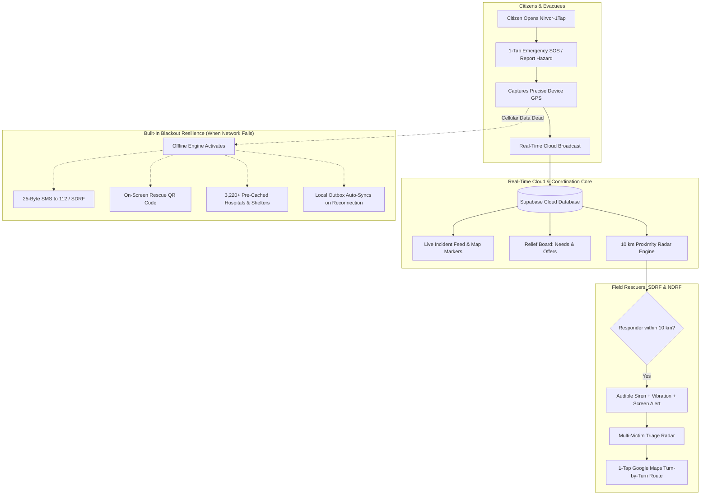
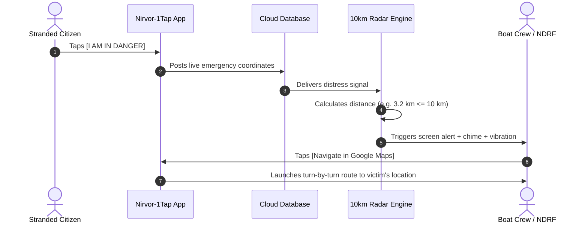

# 🛡️ NIRVOR-1TAP (Northeast Connect)
### Real-Time Community Emergency & Disaster Coordination Platform for North East India

> **A modern, full-featured civic disaster response platform built for the 8 North Eastern states of India.**  
> Connects citizens in danger, field rescue teams, relief volunteers, and district authorities in real time — with built-in blackout resilience when cellular towers degrade.

---

## 🌊 The Mission in North East India

During every monsoon season, North East India faces severe floods, landslides, and cloudbursts — across the Brahmaputra valley in Assam and the mountainous terrains of Meghalaya, Sikkim, Manipur, Mizoram, Nagaland, Tripura, and Arunachal Pradesh.

When a crisis strikes, people need:
1. **Immediate 1-tap emergency dispatch** without typing long forms or remembering helpline numbers.
2. **Real-time visibility** for rescue teams to locate stranded victims and navigate around roadblocks.
3. **A community relief network** to connect local shelters, drinking water, and rations with families in need.
4. **Guaranteed reliability** — an app that stays functional and never leaves you stranded with a dead white screen when cell towers degrade.

**NIRVOR-1TAP delivers all of this at ₹0 operating cost**, using modern open-source infrastructure (OpenStreetMap, Leaflet, Open-Meteo, Supabase, Web Audio API).

---

## 🧭 System Flow: From Emergency to Rescue



---

## 💡 Complete Feature Breakdown

### 1. 1-Tap Emergency SOS Dispatch
- **What it does**: A prominent red button that allows anyone in life-threatening danger to summon help in seconds.
- **Why it matters**: In a flash flood or landslide, there is zero time to create accounts, write descriptions, or browse websites.
- **How it works**:
  - Automatically fetches the victim's high-accuracy GPS coordinates.
  - 1-tap selection of emergency type (Flood, Landslide, Trapped, Medical, Roadblock) and headcount.
  - Immediately broadcasts the distress call to the live cloud database and all active field responders in the district.
  - Pre-fills a native emergency SMS to **112 (National Emergency)** and SDRF as an instant backup.

---

### 2. Multi-Victim & Multi-Responder Dispatch Radar
- **What it does**: A dedicated tactical command queue for field rescue teams, boat crews, and SDRF personnel.
- **Why it matters**: Natural disasters rarely affect only one person. Rescuers need a clean, structured triage list to prioritize concurrent rescues across flooded sectors.
- **How it works**:
  - Responders activate **"Responder Mode"** in the top navigation bar.
  - The system tracks the responder's live GPS location and continuously scans for distress calls.
  - A floating **Radar Bubble** displays the total count of active victims in real time.
  - Clicking the bubble opens the **Multi-Victim Triage Board**:
    - Interactive carousel (`<` and `>`) to review each stranded victim.
    - Displays exact coordinates, severity level, victim count, and distance.
    - One-tap **[🧭 NAVIGATE IN GOOGLE MAPS]** button opens live turn-by-turn driving or boating directions from the responder's current location straight to the victim.



---

### 3. 10 km Proximity Radar Alert (Acoustic & Tactile)
- **What it does**: Automatically alerts field responders whenever an emergency SOS is triggered within a 10 km radius.
- **Why it matters**: Responders driving through torrential rain or operating inflatable boats cannot stare at a screen. They need loud audio and physical vibration to grab their attention.
- **How it works**:
  - Automatically calculates real-time ground distance to active incidents using the Haversine formula.
  - When an emergency occurs within 10 km:
    - **Acoustic**: Synthesizes a loud two-tone siren directly in the browser via the Web Audio API. Because the sound is generated programmatically in code, it never depends on downloading external MP3 files!
    - **Tactile**: Triggers hardware vibration patterns on mobile phones (`navigator.vibrate`).
    - **Visual**: Drops an emergency banner across the screen with victim distance and category.
    - **System Notification**: Fires native OS notifications if the browser is minimized.

---

### 4. Live Interactive Disaster Map
- **What it does**: A dynamic disaster map displaying verified emergency facilities, reported road hazards, and live distress calls.
- **Why it matters**: Visual situational awareness helps citizens choose safe evacuation paths and helps rescue teams avoid submerged roads.
- **How it works**:
  - **Base Layer Switcher**: 1-tap switching between **Street** (road layout), **Terrain** (topographic contours for landslide risk), and **Satellite** (real aerial imagery to view river embankments).
  - **Layer Filtering**: Filter markers by All Layers, Hospitals & Clinics, Shelters, Police, Fire & Rescue, and Active Incidents.
  - **Smart De-clustering**: If multiple reports happen at the same town or hub, the map gently fans them out radially so every marker is clearly visible and clickable.
  - **Category-Specific Map Icons**:
    - 🪨 **Landslide** (Amber teardrop pin `#D97706`)
    - 🌊 **Flood** (Blue teardrop pin `#2563EB`)
    - 🚧 **Roadblock** (Orange teardrop pin `#EA580C`)
    - ⚡ **Power Outage** (Yellow teardrop pin `#CA8A04`)
    - 🚑 **Medical Emergency** (Red teardrop pin `#DC2626`)
    - 🚨 **Life-Threatening SOS** (Pulsing Red pin `#DC2626`, 32px)
  - **1-Tap Focus**: Clicking any incident in the "Active Incidents" list smoothly flies the map directly to that location at zoom 15, highlights the marker, and opens its popup.
  - **Auto-Fit Bounds**: Clicking the "Incidents" filter automatically zooms to frame all active incidents across the state.

---

### 5. Real-Time Community Incident Reporting
- **What it does**: Allows local residents and ward volunteers to crowdsource real-time reports of road washouts, rising water levels, fallen trees, or broken bridges.
- **Why it matters**: Official disaster reports often take hours or days to compile. People living on the ground spot dangers first.
- **How it works**:
  - Select category, severity (Low, Moderate, High, Critical), State, and Hub.
  - Attach live GPS coordinates or select the general hub neighborhood.
  - **Instant Local Update**: The report immediately appears on the user's map and feed without waiting for server response.
  - **Cloud Sync**: Syncs to Supabase so all other connected users and authorities see the update within seconds.

---

### 6. Dual-Sided Community Relief Board (Mutual Aid)
- **What it does**: A community mutual-aid board connecting people who need relief supplies with volunteers and NGOs offering them.
- **Why it matters**: Centralized relief often gets bottlenecked. Nearby gurudwaras, clubs, and residents often have dry rations, clean drinking water, or boats ready to deploy if they know where to go.
- **How it works**:
  - **"I Need Help"**: Request drinking water, food packets, emergency medicines, rescue boats, or report missing persons.
  - **"I Want to Help"**: Post available resources (e.g. "We have 300 drinking water packets and 1 generator at Panbazar").
  - **Zero Login Friction**: No accounts or passwords required — anyone can post in under 20 seconds.
  - **Lifecycle Tracking**: Posts update from `Open` $\rightarrow$ `Claimed` $\rightarrow$ `Fulfilled` to prevent duplicated effort.

---

### 7. Real-Time Weather Risk Engine & Advisory Score
- **What it does**: Automatically computes a real-time Disaster Risk Score (0 to 100) and advisory alert for each district.
- **Why it matters**: Gives citizens proactive warning before rivers overflow or slopes give way.
- **How it works**:
  - Connects to Open-Meteo REST API (completely free, zero API keys required).
  - Analyzes hourly rainfall rate, 24-hour total accumulation, and wind speed.
  - Tailored specifically to North East India's geography:
    - *Valleys (Assam)*: Weighted for 24-hour cumulative rainfall (river flooding).
    - *Hills (Meghalaya, Sikkim, Arunachal)*: Weighted for sudden high-intensity bursts (flash floods & landslides).
  - Simple 4-tier risk status:
    - 🟢 **LOW (0-29)**: Normal conditions.
    - 🟡 **MODERATE (30-59)**: Heavy rain expected; stay alert.
    - 🟠 **HIGH (60-79)**: Flood risk high; prepare emergency kits.
    - 🔴 **CRITICAL (80-100)**: Immediate evacuation warning.

---

### 8. 🛡️ Built-In Blackout Resilience & Offline Safety Net (Feature Highlight)
- **What it does**: A built-in offline engine that prevents the platform from crashing or becoming useless when cellular internet towers collapse during severe floods or landslides.
- **Why it matters**: While Nirvor-1Tap is primarily a real-time cloud coordination platform, natural disasters frequently destroy cellular data towers. Normal websites show a dead white screen; Nirvor-1Tap seamlessly activates its offline fallback toolkit.
- **How it works**:
  - **100% Offline PWA Shell**: Registered Service Worker (`public/sw.js`) caches the entire platform shell so it opens instantly even with zero internet.
  - **3,220+ Pre-Cached Facilities**: The complete database of **3,220 verified hospitals, clinics, police stations, and relief shelters** across all 8 NE states is stored locally on the device (`facilities.json`).
  - **2G SMS Channel Fallback**: When mobile data is dead but basic 2G voice/SMS channels still operate, the SOS modal pre-fills a native 25-byte SMS packet to **112 (National Emergency)** with exact GPS coordinates.
  - **On-Screen Rescue QR Code**: For complete cellular blackouts (0G), the app generates an on-screen QR code containing the victim's triage status and coordinates. Arriving rescue boats or helicopters can scan it directly with their camera with zero network needed.
  - **Store-and-Forward Outbox**: Any hazard reports or relief posts written while offline are saved in `localStorage`. The second your device reconnects to a signal, the app automatically flushes the queue to the cloud.

---

### 9. Ultra Low-Bandwidth & High-Contrast Emergency Modes
- **What it does**: Two specialized operating modes for difficult physical environments.
- **Why it matters**:
  - **Low-Bandwidth Mode**: Hides tile maps and heavy assets. Reduces data consumption to **under 5 KB** — ideal for weak 2G signals or preserving critical phone battery.
  - **High-Contrast Emergency Mode**: Boosts font sizes by 25%, adds high-contrast borders, and enlarges touch targets for elderly citizens or people viewing screens in torrential rain or pitch-black darkness.

---

### 10. 4 Regional Languages
- **What it does**: Instant language switcher for:
  - 🇬🇧 **English**
  - 🇮🇳 **Assamese (অসমীয়া)**
  - 🇮🇳 **Bengali (বাংলা)**
  - 🇮🇳 **Hindi (हिन्दी)**
- **Why it matters**: In an emergency, safety instructions and button labels must be understood immediately in the local mother tongue.

---

### 11. Emergency Helplines & Survival Checklists
- **What it does**: 1-tap dialer for essential emergency helplines and interactive offline safety checklists.
- **Why it matters**: During a power cut or crisis, you cannot search the web for control room contact numbers.
- **How it works**:
  - Direct 1-tap call buttons (`tel:`) for **112, 108 (Ambulance), 101 (Fire), 100 (Police), 1070/1077 (Disaster Helplines)**, NDRF battalions, and state control rooms for all 8 states.
  - Actionable checklists for **Flood Preparedness, Landslide Safety, and Earthquake Response** that can be checked off on-screen anytime.

---

## 🏗️ Technology Stack

| Layer | Technology | Purpose |
| :--- | :--- | :--- |
| **Framework** | **Next.js 16 (App Router)** | High-performance server rendering, static optimization, and API routes. |
| **Frontend** | **React 19 + Tailwind CSS v4** | Lightweight, responsive interface optimized for budget mobile devices. |
| **Mapping** | **Leaflet + OpenStreetMap** | Open-source interactive map without proprietary SDK locks or API charges. |
| **Cloud Database** | **Supabase (PostgreSQL REST)** | Real-time cloud persistence with automatic fallback to memory. |
| **Blackout Engine** | **Service Worker (`public/sw.js`)** | Caches app shell, facilities database, and manages offline outbox sync. |
| **Sound Synthesis** | **Web Audio API** | Generates emergency siren programmatically in browser code (zero MP3 downloads). |
| **Weather Telemetry** | **Open-Meteo REST API** | Completely free open-source meteorological data (zero API keys). |

---

## 🚀 How to Deploy on Vercel (Under 2 Minutes)

1. Open [https://vercel.com/new](https://vercel.com/new).
2. Import your GitHub repository: **`Debojyoti1104/Nirvor-1Tap`**.
3. Vercel automatically detects the framework as **Next.js**.
4. In **Environment Variables**, add:
   - `NEXT_PUBLIC_SUPABASE_URL` = `https://zhhnjscexviylbjudwrh.supabase.co`
   - `NEXT_PUBLIC_SUPABASE_ANON_KEY` = *(your Supabase publishable key)*
   - `SUPABASE_SERVICE_ROLE_KEY` = *(your Supabase service role key)*
5. Click **Deploy**. Your site will be live with HTTPS and global CDN distribution in about 60 seconds!

---

## 💻 Running Locally

```bash
# 1. Clone repository
git clone https://github.com/Debojyoti1104/Nirvor-1Tap.git
cd Nirvor-1Tap

# 2. Install dependencies
npm install

# 3. Start development server
npm run dev
```

Open [http://localhost:3000](http://localhost:3000) in your browser.

---

## 🌟 Why This Architecture Works

1. **Active Real-Time Cloud**: Delivers instant cloud updates, live map sync, mutual-aid relief boards, and 10 km responder radar when connected.
2. **Guaranteed Blackout Safety Net**: When floods destroy cell towers, the platform seamlessly falls back to 2G SMS, scannable QR codes, 3,220 pre-cached hospitals, and automatic outbox sync.
3. **Zero Financial Overhead**: Built entirely on free, open infrastructure — scalable by district authorities and civic groups at ₹0 software cost.
4. **Human-Centered Civic Design**: Zero accounts required, large touch targets, high contrast, and 4 regional languages.

---

*Built with ❤️ for the resilient communities and emergency responders of North East India.*
